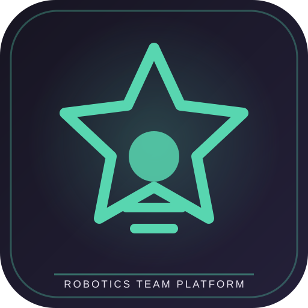

**ROBOTICS TEAM PLATFORM**

---

# Rabbitech BIOGLOW FLLC

**A web platform for the Rabbitech BIOGLOW FIRST LEGO League team.**

The project brings team tools, match preparation, scoring workflows, and site operations together in one web application.

[Open the platform](https://rabbitech-fllc.vercel.app)

## What the platform includes

The repository contains the web application and its supporting server-side integrations. Current modules include:

- **FLL workspace:** mission information, strategy resources, and team-oriented tools.
- **Scoring and results:** match records and public ranking workflows.
- **Team workspace:** team membership, shared rounds, and team communication features.
- **Internationalization:** a multi-language interface with shared translation resources.
- **Notices:** global announcements and scheduled messages.
- **Administration:** controlled admin navigation and management tools.
- **Operations and diagnostics:** health checks for critical data and backend functions, recent error visibility, and integrity reports.
- **Maintenance and recovery:** maintenance mode, configuration snapshots, and guided restore operations.
- **Media discovery:** a YouTube search integration through server-side endpoints.

The application evolves frequently. Some modules depend on Supabase configuration, database policies, external API credentials, and deployment state; check the running site before assuming a feature is enabled.

## Technology

| Layer | Technology |
| --- | --- |
| Frontend | HTML, CSS, JavaScript |
| Hosting | Vercel |
| Database and backend | Supabase |
| Server-side integrations | Vercel Functions and Supabase Edge Functions |
| Automation | GitHub Actions |
| Internationalization | JavaScript translation modules |

## Repository structure

| Path | Purpose |
| --- | --- |
| index.html | Main application interface. |
| assets/css/ | Application and mobile layout styles. |
| assets/js/ | Navigation, internationalization, consent, and feedback modules. |
| api/ | Server-side API endpoints, including YouTube search. |
| supabase/functions/ | Supabase Edge Functions. |
| supabase/migrations/ | Database schema, policies, and function changes. |
| docs/ | Repair notes and implementation documentation. |
| backups/ | Versioned source backups used during maintenance. |

## Production release

The release manifest in assets/rabbitech-release.json records:

- **Version:** 2026.10.30.1
- **Channel:** production
- **Release date:** 30 October 2026

The release notes cover improvements to ranking explanations, match analysis, snapshot validation, backend health diagnostics, guided repair, duplicate-team integrity reports, maintenance operations, scheduled notices, and update-center checks.

The release manifest describes the intended release. Always confirm the active deployment in Vercel before treating a local commit as live production.

## Development and deployment

1. Clone the repository.
2. Review the frontend files and the current Supabase migrations.
3. Configure the required Vercel and Supabase environment variables in the deployment dashboard.
4. Apply database migrations in the intended order.
5. Test public pages, authenticated team workflows, admin permissions, and mobile layouts.
6. Deploy through the connected Vercel project and verify the production URL.

Do not commit API keys, service-role keys, private tokens, or database credentials. Keep privileged operations on the server and preserve Supabase Row Level Security (RLS) as the authorization boundary. Hiding an admin button in the interface is not a security control.

## Validation checklist

Before a production release, verify:

- Public ranking behavior and the minimum-round eligibility rules.
- Team creation, membership, shared rounds, and chat permissions.
- Admin and non-admin access using separate test accounts.
- Notices, scheduled notices, language switching, and mobile navigation.
- Snapshot creation and restoration with a verified before/after state.
- Backend health checks and error reporting.
- YouTube integration with valid server-side credentials.

## Project context

Rabbitech BIOGLOW FLLC is a team project built to support robotics preparation and operations. It is not an official FIRST or LEGO platform.
